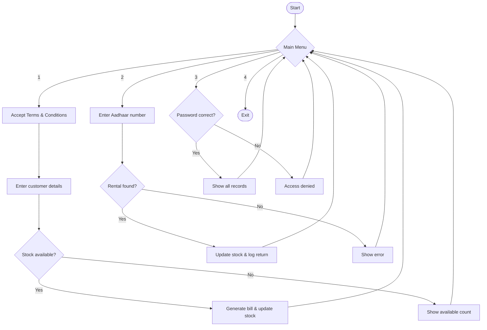

<div align="center">

# 🛵 Bike Rental Project

### Activa Rental House: Command-Line Rental Management System

<p>
  
  
  
  
</p>

<p>
  
  
  
  
  
</p>

**A simple, dependency-free Python application to manage scooter rentals, billing and stock, all from the terminal.**

[Features](#-features) • [Quick Start](#-quick-start) • [How It Works](#-how-it-works) • [Sample Bill](#-sample-bill) • [Roadmap](#-roadmap)

</div>

---

## 📖 Table of Contents

- [About](#-about)
- [Features](#-features)
- [Tech Stack](#-tech-stack)
- [Rental Terms & Pricing](#-rental-terms--pricing)
- [Quick Start](#-quick-start)
- [Menu Options](#-menu-options)
- [How It Works](#-how-it-works)
- [Sample Bill](#-sample-bill)
- [Project Structure](#-project-structure)
- [Security Notes](#-security-notes)
- [Roadmap](#-roadmap)
- [Contributing](#-contributing)
- [Author](#-author)
- [License](#-license)

---

## 🎯 About

**Bike Rental Project** is a console-based rental management system built for a small scooter (Activa) rental shop. It lets customers rent and return vehicles, generates itemised bills automatically, keeps a live count of available stock, and gives the shop owner a password-protected view of all rental records.

The project uses only the Python standard library, so there is nothing to install beyond Python itself.

---

## ✨ Features

| | Feature | Description |
|---|---------|-------------|
| 🛵 | **Rent** | Capture customer details, rental days and quantity. The bill is generated instantly. |
| 🔄 | **Return** | Return by Aadhaar number. Partial returns are supported and stock updates automatically. |
| 🔐 | **Owner Panel** | Password-protected access to all rental records and current stock. |
| 📊 | **Live Stock** | The number of available Activas is always visible. |
| 🧾 | **Auto Billing** | Every bill and return entry is saved to `Activahouse_bill.txt`. |
| ✅ | **Input Validation** | Days and quantity must be valid positive numbers. |
| 🚫 | **Duplicate Check** | A customer with an active rental must return before renting again. |

---

## 🧰 Tech Stack

<p>
  
  
  
  
</p>

| Component | Technology |
|-----------|------------|
| Language | Python 3.6+ |
| Interface | Command Line (CLI) |
| In-memory data | Python dictionary |
| Bill storage | Plain text file |
| External libraries | None |

---

## 💰 Rental Terms & Pricing

1. 🪪 **Aadhaar Card** is mandatory.
2. 🚗 **Driving Licence** is mandatory.
3. 💵 **One Activa for one day: ₹500**

```
Total Price = ₹500 × Number of Activas × Number of Days
```

---

## 🚀 Quick Start

### Prerequisites

- [Python 3.6 or higher](https://www.python.org/downloads/)

### Installation

1. Click the green **Code** button on this repository and choose **Download ZIP** (or clone it with Git).
2. Extract the ZIP and open the folder in a terminal or command prompt.
3. Run the application:

```bash
python Bike_Rental_Project_Faiez.py
```

> 💡 On macOS or Linux, use `python3` instead of `python`.

---

## 🎛 Menu Options

| Option | Action | Description |
|:------:|--------|-------------|
| **1** | 🛵 Rent | Rent one or more Activas |
| **2** | 🔄 Return | Return rented Activas |
| **3** | 🔐 Owner | View all records (password required) |
| **4** | 🚪 Exit | Close the application |

---

## ⚙️ How It Works



---

## 🧾 Sample Bill

```
================================================================
                    * ACTIVA RENT BILL *
________________________________________________________________
NAME               :-  Faiez
ADDRESS            :-  Bhopal
AADHAR NUMBER      :-  123412341234
LICENSES           :-  MP04XXXXXXX
PHONE              :-  9999999999
DAYS               :-  3
________________________________________________________________
QUANTITY           :-  2
________________________________________________________________
PRICE              :-  3000
________________________________________________________________
                      * THANK YOU *
================================================================
```

> ℹ️ All sample details above are fictional and for demonstration only.

---

## 📁 Project Structure

```
Bike-Rental-Project/
├── 📄 Bike_Rental_Project_Faiez.py   # Main application
├── 🧾 Activahouse_bill.txt           # Auto-generated bills (created on first rental)
└── 📘 README.md                      # Project documentation
```

---

## 🔒 Security Notes

- The default owner password is defined in the source (`password = "qwert"`). **Change it before real-world use.**
- Customer data is held in memory and bills are stored as plain text. Do not commit real customer data to a public repository.
- Add `Activahouse_bill.txt` to your `.gitignore` to keep generated bills out of version control.

---

## 🗺 Roadmap

- [x] Rent and return workflow
- [x] Automatic bill generation
- [x] Password-protected owner panel
- [x] Input validation
- [ ] Persistent storage (JSON / SQLite)
- [ ] Hashed password stored outside the source code
- [ ] Aadhaar, phone and licence format validation
- [ ] Late-return charges
- [ ] Colourful terminal output
- [ ] GUI version (Tkinter)

---

## 🤝 Contributing

Contributions, issues and feature requests are welcome.

1. Fork the repository
2. Create a feature branch: `git checkout -b feature/your-feature`
3. Commit your changes: `git commit -m "Add your feature"`
4. Push to the branch: `git push origin feature/your-feature`
5. Open a Pull Request

---

## 👤 Author

**Faiez**, Bhopal, Madhya Pradesh, India

---

## 📜 License

This project is licensed under the **MIT License**.

<div align="center">

⭐ If you found this project useful, please consider giving it a star! ⭐

</div>
